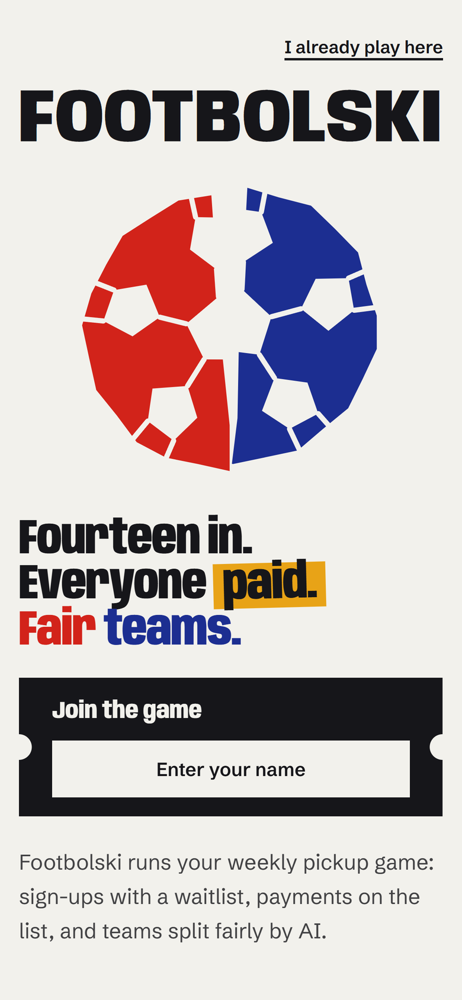
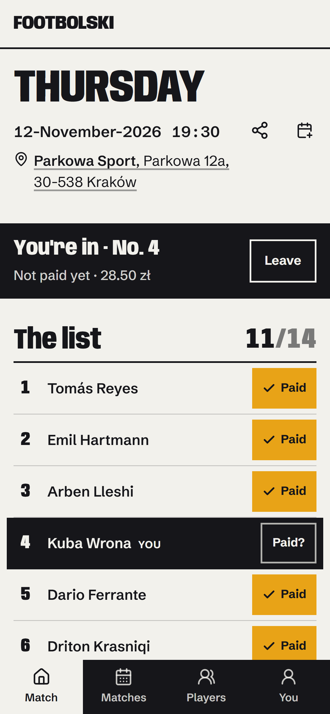
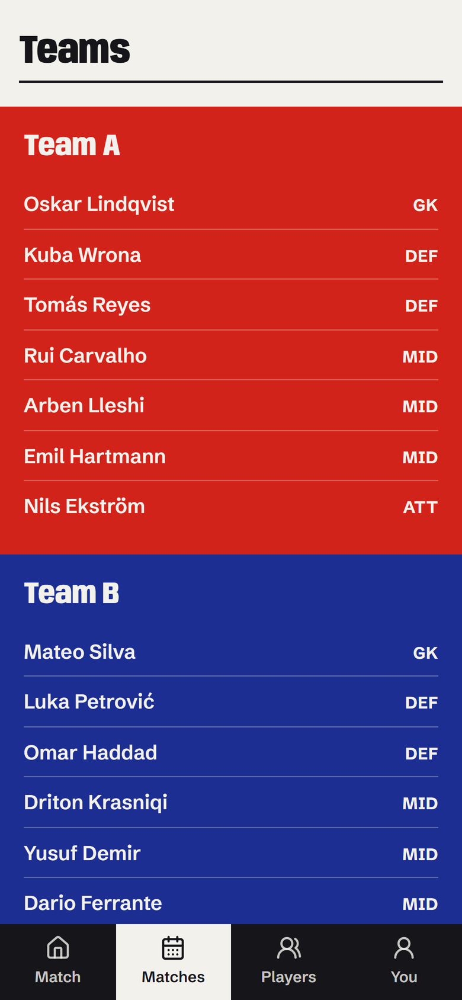
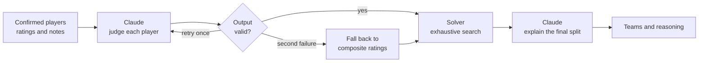
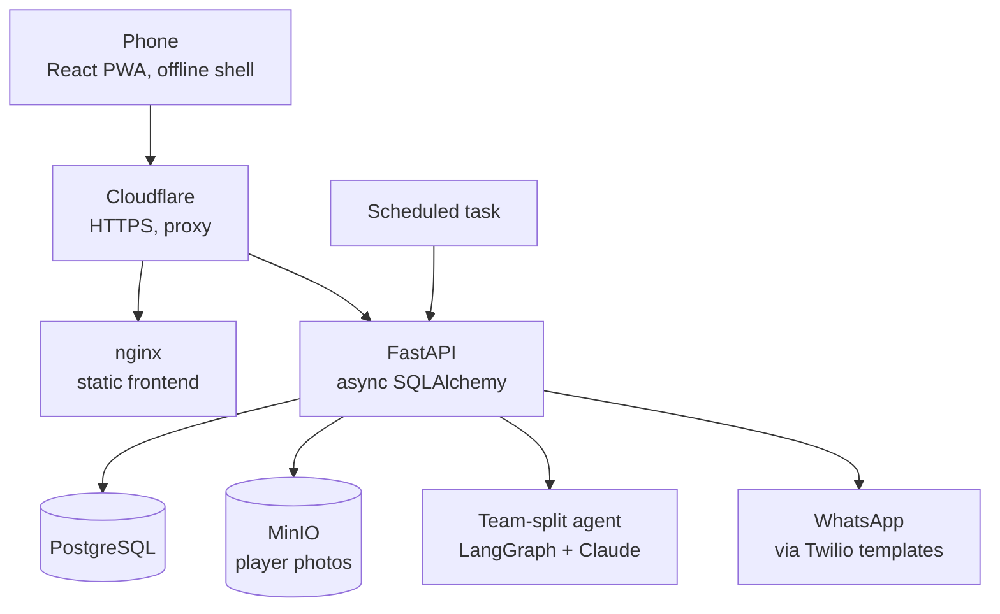

<h1 align="center">Footbolski</h1>

<p align="center">
  A weekly pickup game that runs itself.<br />
  Sign-ups with a waitlist, payments on the list, and teams split by an AI agent.
</p>

<p align="center">
  <a href="https://github.com/user-attachments/assets/6f5f9d99-40d6-4831-8edd-f702bd5f726d">Walkthrough video</a>
  &nbsp;&middot;&nbsp;
  <a href="#the-ai-agent">The AI agent</a>
  &nbsp;&middot;&nbsp;
  <a href="#architecture">Architecture</a>
  &nbsp;&middot;&nbsp;
  <a href="#running-it-locally">Run it locally</a>
</p>

<br />

<table align="center">
  <tr>
    <td align="center" width="33%"></td>
    <td align="center" width="33%"></td>
    <td align="center" width="33%"></td>
  </tr>
  <tr>
    <td align="center"><sub>The front door</sub></td>
    <td align="center"><sub>One match, answered first</sub></td>
    <td align="center"><sub>The split sides</sub></td>
  </tr>
</table>

<p align="center"><sub>Screenshots use invented players and a throwaway database.</sub></p>

<br />

## What it is

Footbolski replaces the WhatsApp poll, the chain of "I'm in" messages and the spreadsheet that a recurring amateur football game usually runs on. I built it for the group I play with in Kraków, about twenty people, and it has been in weekly use since May 2026.

It has three jobs, in this order:

1. **Who is in.** Registration with a capacity limit and a waitlist. When someone drops out, the first person waiting is promoted and told on WhatsApp.
2. **Who has paid.** The price, who to pay and how (BLIK, Revolut or bank transfer) sit on the match. The organiser marks payments, and unpaid players get a reminder.
3. **Fair teams.** Two balanced sides without the argument, with the reasoning shown and a drag-and-drop formation editor to adjust them.

It is a progressive web app, built for one hand on a phone, usually opened from a WhatsApp link.

### A detail from real use

One of our venues accepts Multisport cards, which lower the pitch bill by a different amount every week. The price cannot be fixed in advance, and the organiser pays at the end of the night. So the organiser enters the bill after the match, the app divides it over the players on the list (rounding up, so the group never collects less than the bill), and the WhatsApp payment request goes out twelve hours later, never during quiet hours.

## The AI agent

Team splitting is a small [LangGraph](https://langchain-ai.github.io/langgraph/) pipeline that calls Claude through the Anthropic API. The design rule is that **the model never assigns players to teams.** It judges players, a deterministic solver builds the teams, and the model then explains the result.



**Why it is built this way.** The first version asked Claude for the teams and the reasoning in one response. Measured against a real 14-player match, it averaged a strength gap of 1.79 between the sides where an exhaustive search finds 0.03. In four of five runs it put the two strongest players on the same side while its own reasoning said it had separated them. A language model is a poor combinatorial optimiser and it can describe a result it did not produce, so each job went to the component that is good at it.

**How it works now.**

- **Judge.** Claude reads each player's ratings and the scouting notes kept on their card and returns an effective rating per player, plus weights for what matters in this squad (overall strength, spread of the best players, positional mix). It is called through a strict tool schema, so the output is structured data and not prose.
- **Validate.** Every name must match the roster, nobody may be missing or listed twice, and ratings must be numbers. Bad output is retried once with the error fed back. A second failure degrades to the raw composite ratings, so the split still happens and only loses the note-reading.
- **Bound the influence.** A judgment is clamped to two rating points either side of the player's composite score. A misread note degrades a split. It cannot wreck one.
- **Solve.** A pure-Python solver searches every way to split the squad (3,432 for 14 players, exact up to 22) and returns the lowest-cost assignment. It runs in milliseconds and cannot contradict itself.
- **Explain.** Claude is shown the finished split and asked to describe it. Because the split is input rather than output, the explanation cannot describe a split that was not produced.

The solver and the model contract are plain functions over plain data with no API calls, so the balancing rules can be tested directly. Phone numbers and the internal player tier never reach a client response.

## Architecture



Everything runs on a single self-hosted machine, managed by [Coolify](https://coolify.io). The two applications are built from the Dockerfiles in this repository and deployed from `main`. Database migrations run as part of the backend start-up.

## Engineering notes

- **Identity without accounts.** A player types their name once. It is matched to a player card, and every privileged action (cancelling, splitting teams, entering the bill, sending reminders) is checked on the server against the match's organiser. The interface only decides what to show. The server is the boundary.
- **A scheduler that is safe to run twice.** Invites, payment requests and reminders come from an external tick, not an in-process timer, because the host machine reboots. Every send is guarded by a durable record, so catching up after downtime sends nothing twice. Scheduled messages are never sent outside 08:00 to 22:00 local, each player has a per-match message budget, and a heartbeat makes a dead scheduler visible.
- **Time handled in one place.** Matches are stored as Warsaw wall-clock time and every comparison goes through a single module that applies the offset, so daylight-saving changes do not shift a 19:30 kickoff.
- **Privacy by structure.** The Man of the Match ballot is secret in the schema, not by convention: one vote per voter and no self-votes are database constraints, and no response type exposes who voted for whom.
- **Near-real-time without sockets.** TanStack Query polls every 15 seconds, with optimistic updates for joining and marking payments. For a list that changes a few times a day, that is simpler to run than a WebSocket layer.
- **A design system, written down.** The interface is a printed-poster look with a documented palette, type scale and rules, in [DESIGN.md](DESIGN.md). Product intent and constraints are in [PRODUCT.md](PRODUCT.md).

## Tech stack

| Layer | Technology |
|---|---|
| Frontend | React 18, TypeScript, Vite, Tailwind CSS, TanStack Query, Zustand, dnd-kit, installable PWA with a service worker |
| Backend | FastAPI, async SQLAlchemy 2, asyncpg, Alembic, Pydantic |
| AI | Anthropic Claude (`claude-sonnet-4-6`), LangGraph, a deterministic Python solver |
| Messaging | WhatsApp template messages through Twilio |
| Data | PostgreSQL, MinIO for photos |
| Delivery | Docker, Coolify, nginx, Cloudflare |

## Repository layout

```
frontend/src
  components/    interface primitives, feature components, layout
  hooks/         TanStack Query hooks over the service layer
  services/      one thin wrapper per API resource
  pages/         routed screens
backend/app
  api/v1/        route handlers, kept thin
  services/      business rules, scheduler jobs, the team solver
  agent/         the LangGraph pipeline, prompts and the model contract
  models/        SQLAlchemy models
  schemas/       Pydantic schemas
backend/alembic  numbered migrations
```

## Running it locally

You need Node.js 20 or later, Python 3.12 or later, [uv](https://docs.astral.sh/uv/) and Docker.

```bash
# database
docker compose up -d db

# backend
cd backend
uv sync
uv run alembic upgrade head
uv run uvicorn app.main:app --reload --port 8000

# frontend, in a second terminal
cd frontend
npm install
npm run dev
```

The app is then at `http://localhost:5174`. The backend reads its settings from an environment file. Every option, with its default, is defined in [`backend/app/core/config.py`](backend/app/core/config.py). Team splitting needs an Anthropic API key, and without messaging credentials no messages are sent.

## Status

Footbolski is built for one group today. Roles are a short list of named people, there is no sign-up flow, and one WhatsApp group is wired in. How it becomes something other groups can adopt is an open design question, recorded in [PRODUCT.md](PRODUCT.md). There is no automated test suite yet. The balancing logic was written as pure functions so that it can have one.

## Author

Built and maintained by [Rezart Abazi](https://github.com/rezart95).
